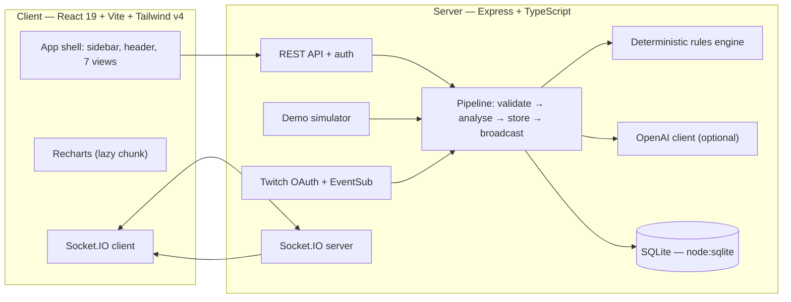

# StreamGuardian AI

> **Safer Streams. Stronger Communities.**

StreamGuardian AI is an AI co-pilot for Twitch streamers and moderators. It listens to live chat, understands what is happening, flags spam and harmful behaviour for **human** review, surfaces the questions a community actually asks, and summarises the stream — without ever taking a moderation action on its own.

Built for the **Codex × TwitchCon Hackathon** as a full-stack MVP.

**Honesty first:** without Twitch credentials the app runs in clearly labelled **Demo Mode** with simulated chat. Nothing is presented as live when it is not, no moderation action is ever automatic, and nothing is ever submitted to Twitch without live credentials and scopes. See [Demo Mode](#demo-mode) and [Known limitations](#known-limitations).

## Features actually implemented

- **Live pipeline** — every chat event is validated (Zod), normalised, analysed, stored in SQLite, and broadcast over Socket.IO: `chat:message`, `moderation:alert`, `incident:new`, `insights:update`, `status:update`.
- **Deterministic moderation engine** — spam phrases, suspicious links (including bare shortener domains), repetition and rate windows, coordinated identical text, caps/flooding, and harassment signals. Severity, confidence, a plain-language explanation, the signals found, a recommended action, and a human-review flag. A single ambiguous message is never classified malicious: repetition, rate, or coordination is required for higher severity.
- **Optional OpenAI classification** — used only when `OPENAI_API_KEY` is set, server-side only, 8-second timeout, Zod-validated JSON response. Chat text is sent as JSON data only, never as instructions. AI output can only escalate to medium/review; it can never auto-escalate to high/critical. Without a key, every analysis is labelled **"Deterministic fallback — no AI call made"**.
- **Sentiment + questions** — lexicon sentiment (positive / neutral / negative / uncertain, with negation handling; no signal → uncertain) and question detection with grouping of similar questions by word overlap.
- **Human-controlled moderation** — review queue with dismiss / mark false positive / approve. Approval requires a confirmation dialog and is recorded in an audit trail with the moderator, time, and note. Approvals are **recorded only, never submitted to Twitch** in this build (it requests only the `user:read:chat` scope; moderation actions need a scope it does not request).
- **Incident timeline** — spam bursts, coordinated activity, flagged messages, and moderator decisions, with filters and a detail view.
- **Community insights** — activity and sentiment charts (Recharts) with window and sample-count labels, deterministic copilot summaries, and suggested replies that require moderator approval. Sends are disabled in Demo Mode.
- **Real Twitch OAuth + EventSub code** — authorization-code flow with one-time state validation, server-side token exchange/refresh, tokens never leave the server, Helix user lookup, EventSub WebSocket client (`channel.chat.message`) with reconnection and graceful failure. Only one scope is requested: `user:read:chat`.
- **Demo Mode simulator** — start / pause / reset / speed (0.5×–4×) / five scenarios (mixed, spam burst, toxic, questions, calm), with seeded scripted bursts. Every simulated message is labelled in the UI.
- **Security basics** — startup env validation (fail fast, production requires `SESSION_SECRET`), rate limits on login/demo/moderation endpoints, demo-only moderator sessions gating privileged endpoints, safe error shapes, no token logging, graceful shutdown.

## Architecture



Shared TypeScript types live in `shared/src/types.ts` and are imported by both sides.

## Prerequisites

- **Node.js >= 22** (the server uses the built-in `node:sqlite`; Node 24 was used during development).
- npm 10+.
- No database server needed. No Twitch or OpenAI account needed for Demo Mode.

## Local setup

```bash
npm install          # installs root, server, and client workspaces

# Demo Mode (no credentials needed):
npm run dev          # server on http://localhost:4000, client on http://localhost:5173

# Or run the production builds:
npm run build
npm start            # serves the API; serve client/dist/ with any static host,
                     # or run `npm --prefix client run preview` (proxies /api to :4000)
```

On first start the server seeds a small set of demo messages so the dashboard is not empty.

## Environment configuration

Copy `.env.example` to `.env` in the project root (the server reads it via dotenv). All values are optional except `SESSION_SECRET` in production:

| Variable | Purpose | Default |
| --- | --- | --- |
| `PORT` | API port | `4000` |
| `CLIENT_URL` | Client URL, used for OAuth redirects | `http://localhost:5173` |
| `DATABASE_PATH` | SQLite file location | `./data/streamguardian.sqlite` |
| `SESSION_SECRET` | Demo session cookie secret (required in production) | ephemeral dev secret + warning |
| `NODE_ENV` | `development` / `production` | `development` |
| `TWITCH_CLIENT_ID` / `TWITCH_CLIENT_SECRET` / `TWITCH_REDIRECT_URI` | Twitch app credentials | unset → Demo Mode only |
| `OPENAI_API_KEY` / `OPENAI_MODEL` | Optional AI classification | unset → deterministic fallback |

If only some Twitch variables are set, the server logs a warning at startup and stays in Demo Mode. Secrets are never logged and never sent to the browser.

## Twitch app setup + callback config

1. Create an app at <https://dev.twitch.tv/console/apps>.
2. Set its **OAuth Redirect URL** to exactly `http://localhost:4000/api/auth/twitch/callback` (or your `TWITCH_REDIRECT_URI`).
3. Copy the Client ID and Client Secret into `.env` with the same redirect URI.
4. Restart the server and click **Connect with Twitch** in Settings.
5. The callback validates the one-time `state` value, exchanges the code server-side, and opens an EventSub WebSocket subscription to `channel.chat.message`. Tokens stay on the server. Disconnecting returns the app to Demo Mode.

Only the `user:read:chat` scope is requested. Moderation actions are deliberately not submitted: they would require `moderator:manage:banned_users` plus explicit re-authorization, which this MVP does not request.

## Database: migrate / seed

There is no migration step. On startup the server creates the SQLite schema (`messages`, `analyses`, `incidents`, `decisions`, `question_groups`, `suggestions`) from `server/src/db/store.ts` and seeds a small scripted demo burst plus calm/question messages when the database is empty. To wipe demo data, stop the server and delete the SQLite file (default `./data/streamguardian.sqlite` plus its `-wal`/`-shm` files), or use **Reset demo data** in the UI (moderator sign-in required).

The original plan mentioned Prisma; it was **not** used — Node's built-in `node:sqlite` needs no engine download and works offline. This is recorded honestly in `BUILD_REPORT.md`.

## Test commands

```bash
npm test            # server (60 tests) + client (7 tests)
npm run test:server # Vitest, server only
npm run test:client # Vitest, client payload-schema tests only
```

Server tests cover spam/repetition/coordinated detection, sentiment and question grouping, OpenAI response validation, env validation, OAuth state validation, pipeline + simulator behaviour, API error shapes, 401s on privileged endpoints, demo rate limiting, and Demo Mode status reporting. Client tests cover Zod validation of every socket/REST payload shape the UI renders (malformed payloads are dropped, never rendered).

## Demo Mode instructions

1. Start the app with no credentials set. The header and dashboard both say **Demo Mode**.
2. Sign in as a moderator from the header (demo login, no password — demo-only session).
3. In **Dashboard** or **Live Chat**, press **Start simulator** and pick a scenario. Messages flow live; flagged ones appear in **AI Moderation** with reasons.
4. Review an alert: dismiss it, mark it a false positive, or approve it (confirmation dialog first). Approvals are recorded as **not submitted to Twitch**.
5. Open **Community Insights** for charts and the copilot summary; open **Important Questions** and use **Suggest a reply** to create a suggestion, then approve or dismiss it in Insights.
6. **Reset demo data** clears everything and re-seeds.

## Deployment steps

This MVP has **not been deployed anywhere**. To deploy it honestly:

1. Provision a Node >= 22 host (VPS, Fly.io, Render, or similar). Do not commit `.env`.
2. Set `NODE_ENV=production`, a long random `SESSION_SECRET`, `CLIENT_URL` to the public client URL, and `DATABASE_PATH` to persistent storage.
3. `npm install --omit=dev && npm run build`, then run `npm start` behind a reverse proxy with HTTPS, serving `client/dist/` as the static site.
4. Replace the demo-only moderator session with a real identity provider before any public use — the current cookie session is **not** production authentication.
5. For real Twitch chat, configure the Twitch app with the production redirect URI.

## Known limitations

- **Demo-only auth.** The moderator session is an in-memory signed cookie with no password. It gates the UI controls for the demo only and must be replaced before production use.
- **No Twitch write actions.** Approvals are recorded, never submitted. Sending chat replies is disabled; suggestions require approval and are never auto-sent.
- **Deterministic engine limits.** The rules engine and lexicon sentiment are heuristics: they can miss novel abuse and can flag benign repetition (e.g. chat memes). Every flag needs a human.
- **Single-process, single-file SQLite.** No horizontal scaling; the demo database is local only. PostgreSQL would be needed for a multi-instance deployment.
- **OpenAI is classification-only.** Summaries are deterministic templates built from stored events, even when a key is set.
- **EventSub without credentials is untested live.** The OAuth/EventSub code is real and unit-tested for state validation and scope handling, but no live Twitch connection was exercised during development (no credentials were available). Connection states (disconnected / connecting / connected / error) are reported honestly by the server.
- **Accessibility/verification scope.** The UI was built to WCAG 2.2 AA practices (skip link, focus-visible rings, labelled controls, aria-live announcements, reduced-motion support) and verified by typecheck, tests, builds, and an end-to-end smoke run — but no screen-reader or live-browser audit was performed in this environment. See `BUILD_REPORT.md`.

## Project structure

```text
.
├── client/            # React + Vite + Tailwind v4 + Recharts + Socket.IO client
│   ├── src/           # App shell, views, feature components, lib (api/socket/schemas)
│   └── test/          # Client payload-schema tests
├── server/            # Express + TypeScript + Socket.IO + node:sqlite
│   ├── src/           # config, routes, middleware, services (moderation/ai/twitch/realtime/analytics)
│   └── test/          # 60 Vitest tests
├── shared/src/types.ts# Types shared by client and server
├── .env.example       # Placeholder configuration (no secrets)
└── BUILD_REPORT.md    # What was built, verification results, known limits
```

## Honest note

This codebase was built with AI coding assistance (**Muse**) from the user's 15-section StreamGuardian spec, with tests and builds run locally and an end-to-end Demo Mode smoke run against the real server. No live Twitch data, login, deployment, or AI call is claimed: every such claim in this README is labelled with the conditions under which it would hold. See `BUILD_REPORT.md` for the exact verification evidence.
